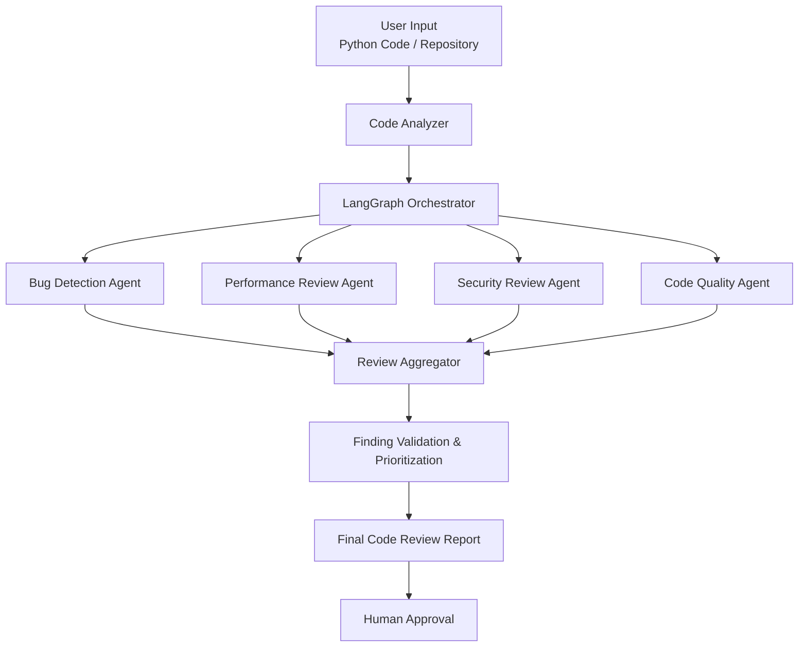

# 🧠 Python Code Review Agent

**An AI-powered, multi-agent Python code review system built with LangChain, LangGraph, and LLMs.**

The goal of this project is to build an intelligent code review system that analyzes Python source code, identifies potential issues, evaluates code quality, and provides actionable recommendations — similar to how an experienced software engineer reviews code.

The system will evolve from a basic LLM-powered reviewer into a sophisticated multi-agent architecture with specialized agents, static analysis tools, and human-in-the-loop validation.

> 🚧 **Project Status: Under Development**

---

## 🎯 Project Objectives

Build an AI agent capable of performing comprehensive Python code reviews across multiple engineering dimensions.

The system aims to identify:

- **Bug Detection:** Identify logical errors, incorrect conditions, edge cases, and potential runtime failures.
- **Performance Analysis:** Detect inefficient algorithms, unnecessary computations, memory overhead, and performance bottlenecks.
- **Code Quality:** Evaluate readability, maintainability, naming conventions, and adherence to Python best practices.
- **Security Analysis:** Detect common vulnerabilities, insecure coding patterns, hardcoded secrets, and unsafe operations.
- **Concurrency Analysis:** Identify potential race conditions, deadlocks, improper asynchronous programming, and thread-safety issues.
- **Best Practices:** Recommend improvements involving type hints, exception handling, modularity, and Pythonic implementations.

## 🏗️ Architecture

The project will follow a modular, multi-agent architecture orchestrated using LangGraph.

### High-Level Architecture



### Core Components

| Component | Responsibility |
|---|---|
| Code Analyzer | Parse source code and extract relevant code structures |
| LangGraph Orchestrator | Coordinate agents and manage workflow execution |
| Bug Detection Agent | Identify logical errors and potential bugs |
| Performance Agent | Analyze algorithmic and runtime inefficiencies |
| Security Agent | Identify security vulnerabilities |
| Code Quality Agent | Evaluate maintainability and coding standards |
| Review Aggregator | Consolidate findings and eliminate duplicates |
| Validation Layer | Validate findings and prioritize issues |
| Human Approval | Allow developers to review recommendations before applying changes |

*The architecture represents the target design. Components will be implemented incrementally.*

## 🛠️ Technology Stack

| Technology | Purpose |
|---|---|
| Python 3.12+ | Core programming language |
| uv | Python package and environment management |
| LangChain | LLM integration and agent development |
| LangGraph | Agent orchestration and workflow management |
| Groq | LLM inference provider |
| Llama | Language model |
| Pydantic | Structured data validation |
| Ruff | Python linting and formatting |
| Bandit | Security analysis |
| Pytest | Unit and integration testing |
| FastAPI | API layer (planned) |

## 📂 Project Structure

```text
python-code-review-agent/
│
├── pyproject.toml
├── uv.lock
├── .python-version
├── .env.example
├── .gitignore
├── README.md
│
├── src/
│   └── python_code_review_agent/
│       ├── __init__.py
│       ├── main.py
│       │
│       ├── agents/
│       │   └── __init__.py
│       │
│       ├── graph/
│       │   └── __init__.py
│       │
│       ├── prompts/
│       │   └── __init__.py
│       │
│       ├── tools/
│       │   └── __init__.py
│       │
│       ├── schemas/
│       │   └── __init__.py
│       │
│       └── config/
│           └── __init__.py
│
└── tests/
    └── __init__.py
```

### Directory Responsibilities

- `agents/` – Specialized AI agents for different review dimensions.
- `graph/` – LangGraph workflows, nodes, edges, and orchestration.
- `prompts/` – System prompts and agent-specific instructions.
- `tools/` – Static analysis tools and custom Python utilities.
- `schemas/` – Pydantic models and structured output definitions.
- `config/` – Application configuration and environment management.
- `tests/` – Unit tests and integration tests.

## 🚀 Getting Started

### Prerequisites

- Python 3.12+
- uv package manager
- Groq API key (required when LLM integration is implemented)
- Git

### 1. Clone the repository

```bash
git clone https://github.com/pankajsoni22/python-code-review-agent.git

cd python-code-review-agent
```

### 2. Create and synchronize the environment

```bash
uv sync
```

This creates the project's virtual environment and installs dependencies specified in `pyproject.toml`.

### 3. Configure environment variables

Create a `.env` file in the project root:

```env
GROQ_API_KEY=your_groq_api_key
```

Get an API key from [Groq Console](https://console.groq.com/).

Never commit your `.env` file or expose API credentials publicly.

### 4. Run the application

```bash
uv run python -m python_code_review_agent.main
```

### 5. Install additional dependencies

Runtime dependencies:

```bash
uv add langchain langgraph langchain-groq
```

Development dependencies:

```bash
uv add --dev pytest ruff mypy
```

## 🗺️ Development Roadmap

The project will be developed incrementally.

| Phase | Milestone | Status |
|---|---|---|
| 1 | Project initialization and environment setup using uv | 🔄 In Progress |
| 2 | Basic LLM integration using LangChain and Groq | 📋 Planned |
| 3 | Code review prompt engineering and structured outputs | 📋 Planned |
| 4 | LangGraph state management and workflow orchestration | 📋 Planned |
| 5 | Specialized review agents | 📋 Planned |
| 6 | Integration with Ruff, Bandit, and Python AST | 📋 Planned |
| 7 | Conditional workflows and agent decision-making | 📋 Planned |
| 8 | Review aggregation and finding validation | 📋 Planned |
| 9 | Human-in-the-loop approval and code correction | 📋 Planned |
| 10 | FastAPI integration | 📋 Planned |
| 11 | GitHub repository and pull request integration | 📋 Planned |
| 12 | Automated test generation and execution | 📋 Planned |

## 🧪 Example of Expected Output

Given the following Python implementation:

```python
def get_users(user_ids, users):
    result = []

    for user_id in user_ids:
        for user in users:
            if user["id"] == user_id:
                result.append(user)

    return result
```

The expected review report could look like:

```text
CODE REVIEW REPORT

1. PERFORMANCE ISSUE
   Severity: Medium

   Problem:
   Nested loops result in O(N * M) time complexity.

   Recommendation:
   Build a dictionary indexed by user ID
   to improve lookup performance.

2. CODE QUALITY
   Severity: Low

   Problem:
   No type annotations are provided.

   Recommendation:
   Introduce appropriate type hints.

OVERALL REVIEW:
   Improvements recommended.
```

*This is an illustrative target output, not a currently implemented feature.*

## 🔍 Engineering Principles

The project will follow these engineering principles:

- **Modularity:** Keep agents, tools, prompts, and orchestration independent.
- **Scalability:** Support adding new specialized agents without redesigning the entire system.
- **Reliability:** Validate LLM outputs and avoid treating every model-generated finding as fact.
- **Observability:** Track agent execution, latency, token consumption, and failures.
- **Testability:** Support unit testing of individual agents and integration testing of complete workflows.
- **Human-in-the-loop:** Keep developers in control of code modifications.
- **Security:** Protect